<picture>
  <source media="(prefers-color-scheme: dark)" srcset="./dark.svg">
  
</picture>

  
  

---

### 👋 About

IT Infrastructure Lead at an MSP. Designing and operating infrastructure across **20+ customer environments**. Focused on automation, AI integration and scalable system design in real MSP operations.

- 🎯 **Focus:** AI · Automation · Azure · Entra ID · Agents
- 🖥 **End-user computing:** Azure Virtual Desktop, Windows Server, Virtualization
- 🤖 **Building:** MCP servers and AI agents for day-to-day IT operations

---

### 🚀 Featured Projects

MCP servers for MSP tooling, published under [**veeemlab**](https://github.com/veeemlab) and available on npm.

| Project | Description |
|---|---|
| [**datto-rmm-mcp**](https://github.com/veeemlab/datto-rmm-mcp) | 55 tools for the Datto RMM API v2, Copilot Studio compatible |
| [**itglue-mcp**](https://github.com/veeemlab/itglue-mcp) | 56 tools for IT Glue with full read + write support |
| [**autotask-mcp**](https://github.com/veeemlab/autotask-mcp) | Kaseya Autotask PSA: generic access to 180+ entities plus ticket, company and time-entry tools |
| [**microsoft-intune-mcp**](https://github.com/veeemlab/microsoft-intune-mcp) | Microsoft Intune via Graph, multi-tenant MSP support, Copilot Studio compatible |
| [**datto-bcdr-mcp**](https://github.com/veeemlab/datto-bcdr-mcp) | Datto BCDR (SIRIS, ALTO, Cloud SIRIS): backup health across all customers |

---

### 🛠 Tech Stack

**AI & Agents**

**Cloud & Infrastructure**

**Automation**

**Tooling**

